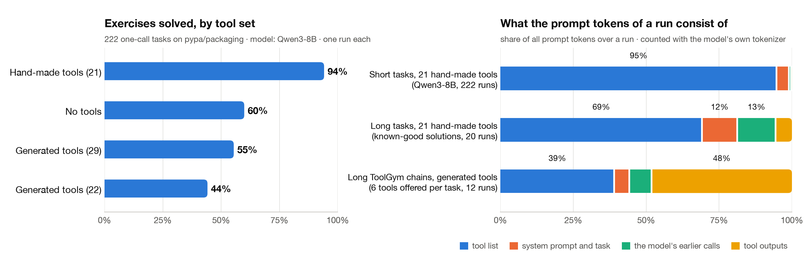

# repo2tools

**From a repository link to verified, chainable tools for LLM agents, with a measurement of whether models can actually use them.**

`repo2tools` takes the URL of a Python library, has an LLM write one tool per library function, and accepts a tool only if running it gives the same result as calling the library directly. It then works out which tools can be chained, again by running them, and measures what a model does with the tools: how often it solves tasks with known answers, and what a run costs in tokens.

<p align="center">
  
</p>
<p align="center"><sub><b>Figure 1.</b> Overview. <i>Top:</i> tool synthesis. An LLM writes each tool, and a sandboxed verifier accepts it only if it agrees with the library on sample inputs. <i>Bottom:</i> the types an LLM proposes are kept only where the tools, when run, accept each other's values (T<sup>kept</sup>); the typed tools feed ToolGym's chain sampling and an agent evaluation, and both produce traces for analysis.</sub></p>

Research prototype from the Tool-Gym track of the project *Agentic Reasoning, Tooling* at the University of Bern.
Author: Kobiljon Muhammadov. Supervisor: Roman Macháček.

## Contents

- [The question](#the-question)
- [What is in the box](#what-is-in-the-box)
- [Results at a glance](#results-at-a-glance)
- [Quick start](#quick-start)
- [Stage 1: from a repo link to tools](#stage-1-from-a-repo-link-to-tools)
- [Stage 2: chains and synthetic traces with ToolGym](#stage-2-chains-and-synthetic-traces-with-toolgym)
- [Stage 3: exercises, traces and repetition](#stage-3-exercises-traces-and-repetition)
- [What each check can and cannot tell](#what-each-check-can-and-cannot-tell)
- [Limitations](#limitations)
- [Repository layout](#repository-layout)
- [Reproducing the results](#reproducing-the-results)
- [Related work](#related-work)

## The question

Coding agents are trained and evaluated with tool interfaces that people wrote by hand. The project asks whether **automatically generated tools, tasks and agent traces** can do the same job. That only works if generated artifacts can be trusted, so the design rule of this repository is:

> An LLM may propose anything. Nothing is kept unless a program has run it and checked it.

Three things follow from that rule, one per stage:

1. **A tool is correct if it agrees with the library it wraps.** The library is the oracle: no hand-written expected values.
2. **A type is correct if its values are interchangeable.** Two parameters share a type only if each accepts the other's values when the tools are run.
3. **A measurement needs known answers.** The exercises take their answers from the library's own test suite, so the score never depends on the tool set being tested.

## What is in the box

| Stage | What it does | Entry point |
| --- | --- | --- |
| 1. Synthesize | Clone a repo at a recorded commit, scan its public API without running it, generate tools, verify them in a sandbox, repair on failure | `repo2tools.py` |
| 2. Chain | Give the tools semantic types checked by execution, load them into ToolGym, run its live chain check and its data-generation pipeline | `generated_to_toolgym.py`, `toolgym_local.py` |
| 3. Measure | Run a model on exercises with and without tools; save every request as a trace; quantify repetition and simulate context compression | `run_model.py`, `analyze_traces.py` |

Also included: 21 reference tools over [pypa/packaging](https://github.com/pypa/packaging) that were written before the pipeline existed (called "hand-made" below, as the baseline the generated tools are compared with), 242 exercises with known answers, and an 86-test suite that needs no GPU and no API key.

## Results at a glance

<p align="center">
  <picture>
    <source media="(prefers-color-scheme: dark)" srcset="docs/results-dark.png">
    
  </picture>
</p>
<p align="center"><sub><b>Figure 2.</b> <i>Left:</i> exercises solved by Qwen3-8B with each tool set. <i>Right:</i> where the prompt tokens of a run go.</sub></p>

All numbers are first results: small models, one run per setting, one library. Each one can be rebuilt from the files in `out/`.

- **Generated tools match hand-made ones where a fitting tool exists, and lose where none was generated.** On the 82 exercises with a fitting generated tool: 74 solved against 72 with hand-made tools. On the other 140: 49 against 137. The gap is in *which* functions get turned into tools, not in the quality of the tools. (The 82 were identified after seeing the results.)
- **Offering unsuitable tools can be worse than offering none.** With 22 generated tools the model solves 44% of the exercises, below the 60% of the run without tools (an earlier run, whose system prompt also differs slightly).
- **Passing every check does not make a tool usable.** `check_specifier_set_unsatisfiable` is correct, but asked whether a constraint *can* be satisfied, the model copies its `true` (at most 1 of 20 solved). Eight range tools return text that no other tool accepts.
- **Types checked by execution give ToolGym chains that survive its validation:** 11 of 33 short chains accepted, against 0 of 15 with hand-written types, whose chains run through automatic casts.
- **Long chains need a richer graph, not more steps.** With 16 links, chains of 8 to 10 calls loop on one tool; none of the 20 sampled was accepted.
- **The tool list dominates the prompt.** It is 60% to 97% of all prompt tokens when 21 or more tools are offered. Sending only the 5 most relevant tools (with a perfect retriever) would save 44% to 81%. Trimming old tool outputs saves 0% to 3% in those runs, but 20% on ToolGym's long chains, where outputs are long lists.
- **Forcing tool calls yields more calls, not better ones.** Forced on every step, all 20 long runs call tools (6 of 20 otherwise), 2 pass, and 250 of 502 calls repeat an earlier call exactly.

<details>
<summary><b>All result tables</b></summary>

Qwen3-8B served with vLLM on an RTX 4090, 30 October 2026, temperature 0, one run per exercise. Details in `out/runs/`.

| Exercises | With tools | Without tools |
| --- | --- | --- |
| Short (222, 1 tool call) | 94% | 60% |
| Long (20, 10 to 23 tool calls) | 0 of 20 | 0 of 20 |
| Long, model may think first | 12 of 20, with 0 tool calls | 10 of 20 |

The same 20 long tasks with tools of different sizes (thinking off):

| Tool set | Calls a task needs | Passed |
| --- | --- | --- |
| 21 small tools | 10 to 23 | 0 of 20 |
| 1 tool per requirement line | 4 to 6 | 1 of 20 |
| 1 tool for the whole task | 1 | 16 of 20 |
| All 23 together | 1 | 16 of 20 |

These are first results: one small model, one run, and 20 long tasks of one kind.

Generated tools, 6 November 2026. Qwen3-Coder-30B writes the tools, and Qwen3-8B uses them on the 222 short exercises:

| Tool set | Tools | Passed |
| --- | --- | --- |
| Hand-made (run again; same score as in October) | 21 | 94% (209) |
| No tools (October run) | 0 | 60% (133) |
| Generated, `--max-tools 60` (the LLM picked 39, 29 accepted) | 29 | 55% (123) |
| Generated, `--max-tools 30` (22 accepted) | 22 | 44% (98) |

- **Where a fitting tool exists, generated tools match hand-made ones:** 74 vs 72 of 82 exercises. These six exercise kinds were chosen after seeing the results.
- **The main gap is choosing tools:** on the other 140 exercises it's 49 vs 137. The LLM skipped most `Version` tools, and the library has no public function to compare two versions, because that is done with operators.
- **A correct tool can still be misused:** `check_specifier_set_unsatisfiable` passes every check, but the model copies its `true` when asked whether a constraint *can* be satisfied (0 of 20).
- **The comparison favours the hand-made tools:** they were written together with these exercises.

Traces of real runs, Qwen3-8B. All numbers are in `out/traces/analysis/repetition.md`:

| Long tasks (20) | Runs with a tool call | Passed | Calls | Exact repeats |
| --- | --- | --- | --- | --- |
| The model decides | 6 | 0 | 49 | 4 |
| First request must call a tool | 20 | 0 | 106 | 5 |
| Every request must call a tool | 20 | 2 | 502 | 250 |

Forcing gets more calls, but not better ones: one run called `evaluate_marker` 38 times with the same arguments. These traces need filtering before anyone trains on them.

Generated tools in ToolGym, 11 November 2026. Qwen3-32B proposes the types and runs ToolGym's pipeline (as writer, judge and challenger). One run each:

| | Generated tools (29, packaging) | Hand-made tools (21) |
| --- | --- | --- |
| Type links between tools | 16, all checked by running them | 144 by ToolGym's rules, of which 62 are noise |
| ToolGym live `chain_check` | 16 of 16 chains pass | not run |
| Short chains (2 to 4 calls): sampled, finished, accepted by ToolGym's validation | 40, 33, **11** | 40, 15, **0** |
| Long chains (8 to 10 calls): sampled, finished, accepted | 20, 12, **0** | 20, 8, **0** |

- **Checked types give usable short chains.** Hand-typed tools get chains through ToolGym's automatic casts (a package name fed into a specifier check), and its validation rejects all of them.
- **Long chains are not solved by asking for more steps.** With 16 links, a long walk loops: one chain is `parse_tag` eight times, and 34 of 104 calls repeat an earlier call exactly.
- **The check finds tools that cannot be chained.** Eight range tools take a constraint like `>=1.0` but return text like `<VersionRange '[1.0, 2.0.dev0)'>`, which no tool accepts. They passed every check of `repo2tools.py`.
- **A harder repo:** more-itertools gives 50 accepted tools of 142 picked. Its values are plain lists, so the LLM found only 2 types and 21 links. Kinds of values work for a domain library like packaging, not for generic data.

</details>

## Quick start

Needs [uv](https://docs.astral.sh/uv/). This replays a known-good solution for every exercise through the tools:

```sh
uv run python run_reference_calls.py out/packaging/exercises.jsonl -- uv run python toolsets/pypa_packaging/server.py
```

The last line should say `242/242 exercises solved by their reference calls`.

To run a model, start an OpenAI-compatible server with tool calling. `cluster/README.md` shows how on UBELIX. Then:

```sh
export OPENAI_API_KEY=<the server's key>
uv run python run_model.py out/packaging/exercises.jsonl --mode tools --base-url http://127.0.0.1:18000/v1 --model qwen3-8b -- uv run python toolsets/pypa_packaging/server.py
uv run python run_model.py out/packaging/exercises.jsonl --mode none --base-url http://127.0.0.1:18000/v1 --model qwen3-8b
python3 -I compare_runs.py out/runs/qwen3-8b-tools.jsonl out/runs/qwen3-8b-none.jsonl
```

## Stage 1: from a repo link to tools

```sh
uv run python repo2tools.py https://github.com/pypa/packaging --commit c1d2a9d \
    --base-url http://127.0.0.1:18000/v1 --model qwen3-8b
```

It clones the repo at a recorded commit, finds the package (`src/` layout or top level), and scrapes its public API. An LLM picks up to `--max-tools` functions, naming each by its full path, which must be in the API. Then it writes a test and the code, one tool per library function. Each tool must pass these checks, with errors going back to the LLM for a few repair rounds (`--repair-rounds`):

| Check | What it means |
| --- | --- |
| `static` | Read without running: one public function, type hints, a docstring, no dangerous imports |
| `loads` | The file imports |
| `fastmcp` | FastMCP accepts it, with the agreed parameters |
| `runs` | It runs on the sample inputs; bad input gives `ValueError`, not a crash |
| `differential` | Same result as a direct library call on the same input |

The result goes to `toolsets/generated/<repo>-<model>/` (one file per tool, `server.py`, `run_server.sh`, `manifest.json`) and `out/generated/<repo>-<model>/` (`report.md`, `api.json`, and `llm_log.jsonl` with every LLM request). First version: pure-Python libraries, one tool per function.

**Limits of the checks.** The same model writes the tool and the direct call it is compared with, in separate requests, so the two can share a misunderstanding of the library. The check also sees only what the sample inputs reach: a tool that drops a requirement's extras passes if no sample has extras. And passing says nothing about whether a model can use the tool, or whether the right functions were chosen. A real score needs exercises with known answers.

**Untrusted code.** Repo code and generated code run only in their own environment under `.cache/envs/`:

- Only repos you name are cloned. The repo is never built or installed: its dependencies come as wheels (`--no-build`), and the package is copied in, so no `setup.py` runs.
- Generated code gets an empty environment, so no API keys.
- On macOS it runs inside `sandbox-exec`: no network, no reading the home folder (SSH keys, the API key), writing only to one scratch folder. `tests/test_repo2tools.py` runs hostile code to check this.
- Other systems have no such sandbox. The tool then warns, and the report says so. Only use repos you trust there.

To score generated tools on exercises, use `run_model.py` with `run_server.sh` as the server command. `run_reference_calls.py` needs the hand-made tool names, so it doesn't work on generated tools.

## Stage 2: chains and synthetic traces with ToolGym

Needs a ToolGym checkout next to this repo (`../tool-gym`) and a model with tool calling (`cluster/serve_qwen3_32b.sbatch`).

```sh
T=toolsets/generated/packaging-coder-60

# 1. types for the generated tools, checked by running them; writes ToolGym's catalog folder
uv run python generated_to_toolgym.py $T --dest ../tool-gym/gym/tools/mcp_servers/catalog --base-url http://127.0.0.1:18000/v1 --model qwen3-32b

# 2. local variants of ToolGym's chain check and pipeline, in its ignored local/ folders
uv run python toolgym_local.py install ../tool-gym

# 3. ToolGym's own checks: the catalog loads, and every 2-step chain runs on the live tools
(cd ../tool-gym && uv run python -m gym.tools.mcp_servers.check --no-report-file)
uv run python toolgym_local.py chains ../tool-gym repo2tools_packaging_coder_60 --tool-server $T/run_server.sh

# 4. synthetic tasks from ToolGym's pipeline, then as traces in our format
uv run python toolgym_local.py generate ../tool-gym repo2tools_packaging_coder_60 --tool-server $T/run_server.sh \
    --base-url http://127.0.0.1:18000/v1 --model qwen3-32b --min-length 2 --max-length 4 --chains 40 --run-name generated-short
uv run python toolgym_traces.py ../tool-gym/results/gym/repo2tools/generated-short-* -o out/traces/toolgym-generated-short.jsonl.gz
```

How the types are made (`generated_to_toolgym.py`):

1. Every tool is called on its sample inputs. Inputs that work, and their outputs, are the examples.
2. An LLM proposes a small shared vocabulary, e.g. `VersionString` for every parameter that takes a version.
3. The claims are tested by running the tools. For every two parameters of a type, the values of one are tried on the other. Every typed output is fed into the parameters that would take it. A claim that fails is withdrawn.
4. On/off flags get a type of their own each, so a true/false result is never chained into an unrelated flag.

The tool server runs in its sandbox the whole time; ToolGym reaches it over HTTP on this computer only. `out/generated/<set>/toolgym_types.md` lists the types, the withdrawn claims and the links. `out/toolgym_runs/` has the summaries of the pipeline runs.

**Limits.** "Accepted" is ToolGym's own validation (an LLM judge, and a challenger that must reproduce the chain from the task text), with the same model in every role. It's one run per setting. A type link says a value is accepted, not that the chain makes sense.

## Stage 3: exercises, traces and repetition

A trace records every request of a run, with its full messages and token counts. `traces.py` describes the format. There's one format for all sources, and anything with a list of tool calls and outputs can be added with `trace_from_calls()`.

```sh
# known-good solutions, no model (the file is 4.6 MB, so it isn't committed)
uv run python collect_reference_traces.py out/packaging/exercises.jsonl -o out/traces/reference-function.jsonl -- uv run python toolsets/pypa_packaging/server.py

# model runs save traces to out/traces/. --tool-choice first|always forces tool use
uv run python run_model.py out/packaging/exercises.jsonl --mode tools --horizon long --tool-choice always \
    --base-url http://127.0.0.1:18000/v1 --model qwen3-8b -- uv run python toolsets/pypa_packaging/server.py

# what repeats, and how many tokens each compression idea would save
uv run --group analysis python analyze_traces.py out/traces/reference-function.jsonl out/traces/*.gz -o out/traces/analysis
```

The analysis counts tokens with the model's own tokenizer and chat template. The parts of a prompt add up to exactly the rendered prompt. Savings are simulated on recorded runs, and their effect on accuracy is not measured.

### Exercise format

One JSON object per line in `out/packaging/exercises.jsonl`.

| Field | Meaning |
| --- | --- |
| `id`, `kind` | e.g. `packaging-specifier_contains-007`, `specifier_contains` |
| `horizon` | `short` (1 call) or `long` (8+ calls in the reference solution) |
| `task` | The task in plain language, as given to the model |
| `answer`, `check` | The correct answer (a JSON value) and how to compare: `exact` (canonical JSON, so `true` ≠ `1`) or `set_equal` (lists, order ignored) |
| `reference_calls` | One known-good solution: `[{"tool", "arguments"}]`. `{"$ref": [i, key...]}` refers to the output of call `i` |
| `reference_answer` | How the answer is built from those outputs |
| `reference_call_count` | Length of the reference solution; a model may need more or fewer calls |
| `library_functions` | Library functions the task depends on |
| `source_repo`, `provenance` | Repo and commit, and where the answer comes from (test case node id, or generator) |

A harness gives the model `task` plus a tool set (these tools, another granularity, distractors, or none), parses the model's final JSON answer, and calls `exercise_check.check(exercise, answer)`. The answer never depends on the tool set, so different tool sets can be compared on the same exercises.

## What each check can and cannot tell

| Check | Catches | Does not catch |
| --- | --- | --- |
| Static read of the generated code | Missing type hints or docstring, dangerous imports, more than one public function | Anything about behavior |
| Same result as a direct library call, on sample inputs | Wrapper bugs: a wrong field, a wrong conversion, a swallowed error, a crash | A misunderstanding shared by the test and the tool (one model writes both); bugs the samples do not reach |
| End-to-end call over real MCP | Differences between the check and the served tool, e.g. a set returned in random order | The same as above |
| Function named by full path, checked against the scanned API | A tool whose code wraps a different function than its name says | A name or description that is technically right but misleads a model |
| Pairwise type check by execution | A parameter whose values the other parameters of its type reject | Values that are accepted but mean something else |
| Output fed into consuming tools | Outputs that no tool can read (dead ends) | Chains that run but make no sense as a task |
| Exercises with known answers | Whether a model, given the tools, gets the right answer | Why it failed; that needs the traces |

Two of these rows exist because of failures in this project. In the first run with a real model, the LLM numbered its picks 1, 2, 3 and a tool named `evaluate_marker` wrapped `DirectUrl.from_dict`, passing every check: that is why functions are now named by path. And the dead-end range tools passed every single-tool check: that is why outputs are now fed into consumers.

## Limitations

- **One library, small models, one run.** Tools were generated mainly for pypa/packaging (with first runs on arrow and more-itertools), written by Qwen3-Coder-30B or Qwen3-32B and used by Qwen3-8B. No variance estimates yet.
- **Pure-Python libraries, one tool per function.** Libraries with native code are refused. Behavior that lives in operators (comparing two versions) has no function to wrap and is missed.
- **The baseline has a home advantage.** The hand-made tools were written together with the exercises.
- **Semantic types suit domain libraries.** On more-itertools, where every value is a plain list, the LLM found 2 types and 21 links for 50 tools.
- **"Accepted" by ToolGym means accepted by an LLM judge and an LLM challenger,** with the same model in every role.
- **Compression savings are simulated** on recorded runs. Their effect on accuracy has not been measured.
- **The sandbox is macOS only** (`sandbox-exec`). Elsewhere generated code runs in its own environment without network or file limits, and the tool says so.

## Tests

```sh
uv run --group dev --group analysis pytest
```

No GPU or API key needed. The LLM and the endpoint are scripted.

## Repository layout

| Path | What it does |
| --- | --- |
| `repo2tools.py` | Repo link to checked tools; see above. |
| `toolsets/generated/` | Generated tool sets, one file per tool. Not reviewed by a person. |
| `generated_to_toolgym.py` | ToolGym types for a generated tool set, checked by running the tools; writes the catalog folder. |
| `toolgym_local.py`, `toolgym_traces.py` | Run ToolGym's chain check and pipeline on tools served from this computer; turn the results into traces. |
| `tool_worker.py` | Checks one generated tool. It runs inside the tool set's environment and sandbox. |
| `traces.py` | The trace format. |
| `collect_reference_traces.py`, `analyze_traces.py` | Known-good solutions as traces; what repeats and what compression would save. |
| `scrape_repo.py` | Static `ast` scan of a package's public API: signatures, types, defaults, docstrings, source location. Never imports the package. |
| `toolsets/pypa_packaging/tools.py` | 21 tools over pypa/packaging (versions, version constraints, requirements, markers, names, wheel files, tags). `GYM_TYPES` holds their ToolGym types. |
| `toolsets/pypa_packaging/coarse_tools.py` | The same library cut coarser: `check_requirement` (one requirement line) and `check_requirements` (a whole list). |
| `toolsets/pypa_packaging/server.py` | Serves the tools over MCP (stdio, or Streamable HTTP with `--http PORT`). `--level function\|feature\|workflow\|all` picks the tool set. |
| `extract_test_cases.py` | pytest plugin: writes the parameters of every collected test case as JSON lines. Collection only; no tests run. |
| `make_packaging_exercises.py` | Builds the exercises. Short ones come from packaging's test cases; the answer is the test's expected value, confirmed by a direct library call. Long ones check a requirements list against a made-up package index. |
| `exercise_check.py` | Stdlib-only answer checker and `$ref` resolver, for any harness that runs the exercises. |
| `run_reference_calls.py` | Replays every known-good solution through an MCP server and checks the answers. This tests the tools, not a model. |
| `run_model.py`, `compare_runs.py` | Run a model on the exercises, and put two runs side by side. |
| `make_handover.py`, `handover/README.md` | Build a self-contained zip of the exercises and tools for Alex's benchmark. |
| `toolsets/pypa_packaging/toolgym_types.py`, `export_toolgym_catalog.py` | Write the tools into a ToolGym checkout as a catalog server. This repo contains no ToolGym code. |
| `analyze_catalog_chains.py`, `check_exercise_edges.py` | Summarise ToolGym's chain listings, and check that the links the exercises need are in ToolGym's graph. |
| `docs/` | The README figures, and `make_figures.py`, which draws them (the results figure from the result files). |
| `cluster/` | How to serve a model on UBELIX, with the Slurm job scripts. |
| `out/` | Results: `baseline/` (ToolGym's catalog today), `packaging/` (API, exercises, tool check), `packaging_toolgym/` (ToolGym's view of our tools), `runs/` (model runs), `traces/` (full traces and their analysis), `generated/` (reports and LLM logs of generated tool sets), `toolgym_runs/` (summaries of ToolGym pipeline runs). |

## Reproducing the results

These steps need clones next to this repo: `../source-repos/packaging` (pypa/packaging at `c1d2a9d`), `../source-repos/arrow`, and `../tool-gym` (private, ask Roman for access).

```sh
# scrape a public API
python3 -I scrape_repo.py ../source-repos/arrow arrow -o out/arrow_api.json
python3 -I scrape_repo.py ../source-repos/packaging/src packaging -o out/packaging/api.json

# ToolGym's catalog today (offline; no LLM, no servers)
(cd ../tool-gym && uv run python -m gym.tools.mcp_servers.check --no-report-file) > out/baseline/check.txt
(cd ../tool-gym && uv run python -m gym.tools.mcp_servers.chain_check --dry-run) > out/baseline/chains.txt
python3 -I analyze_catalog_chains.py out/baseline/check.txt out/baseline/chains.txt

# packaging: test cases, then exercises (test_cases.jsonl is 17 MB and not committed)
(cd ../source-repos/packaging && PYTHONPATH="$OLDPWD:src" TEST_CASES_OUT="$OLDPWD/out/packaging/test_cases.jsonl" \
    uvx --with pretend --with tomli_w pytest --collect-only -q -p no:cacheprovider -p extract_test_cases tests --ignore=tests/property)
uv run python make_packaging_exercises.py --per-kind 20 --long 20 --seed 0

# add the tools to ToolGym, then see which links it finds
uv run python export_toolgym_catalog.py --dest ../tool-gym/gym/tools/mcp_servers/catalog
(cd ../tool-gym && uv run python -m gym.tools.mcp_servers.chain_check --dry-run kobiljon_pypa_packaging_tools) > out/packaging_toolgym/chains_packaging.txt
python3 -I check_exercise_edges.py out/packaging_toolgym/chains_packaging.txt out/packaging/exercises.jsonl \
    ../tool-gym/gym/tools/mcp_servers/catalog/kobiljon_pypa_packaging_tools/mcp_server.json
```

The figures are drawn by `uv run --with matplotlib python docs/make_figures.py`; the results figure reads its numbers from the result files.

## Related work

- **ToolMaker**: [LLM Agents Making Agent Tools](https://aclanthology.org/2025.acl-long.1266/) (ACL 2025) turns papers and repositories into tested tools. `repo2tools` shares the goal and differs in the oracle: the wrapped library itself, through differential testing.
- **CodeGym**: [Generalizable End-to-End Tool-Use RL with Synthetic CodeGym](https://proceedings.iclr.cc/paper_files/paper/2026/hash/1e4322fddd833f83c855660ac65e428d-Abstract-Conference.html) (ICLR 2026) turns coding problems into tool-use environments with verifiable outcomes.
- **Agent World Model**: [Infinity Synthetic Environments for Agentic RL](https://proceedings.mlr.press/v306/wang26jh.html) (ICML 2026) generates executable environments whose tools are exposed through MCP.
- **SERA**: [Soft-Verified Efficient Repository Agents](https://proceedings.mlr.press/v306/shen26o.html) (ICML 2026) generates repository-specific trajectories where full verification is not available.
- **Tool-R0**: [Self-Evolving LLM Agents for Tool-Learning from Zero Data](https://arxiv.org/abs/2602.21320) (2026) co-evolves a task generator and a solver.
- **ToolGym** (Swiss AI; not public) turns MCP tool servers into validated training data through typed tool chains. Stage 2 builds on it and contains none of its code.

## Acknowledgements

Supervised by Roman Macháček. Compute: UBELIX, the HPC cluster of the University of Bern. Models are served with [vLLM](https://github.com/vllm-project/vllm); tools are served with the [Model Context Protocol](https://modelcontextprotocol.io) Python SDK.
